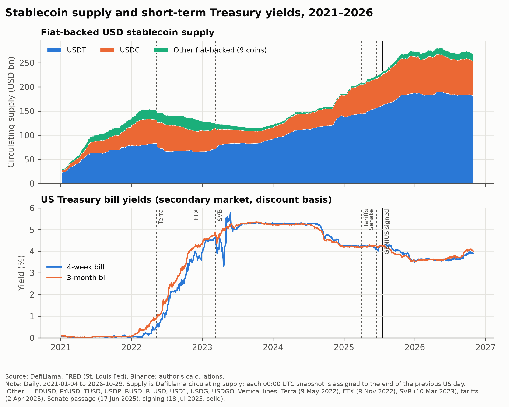
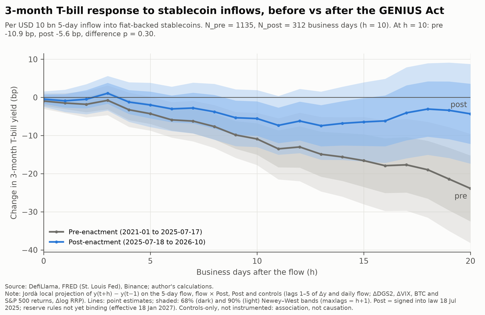
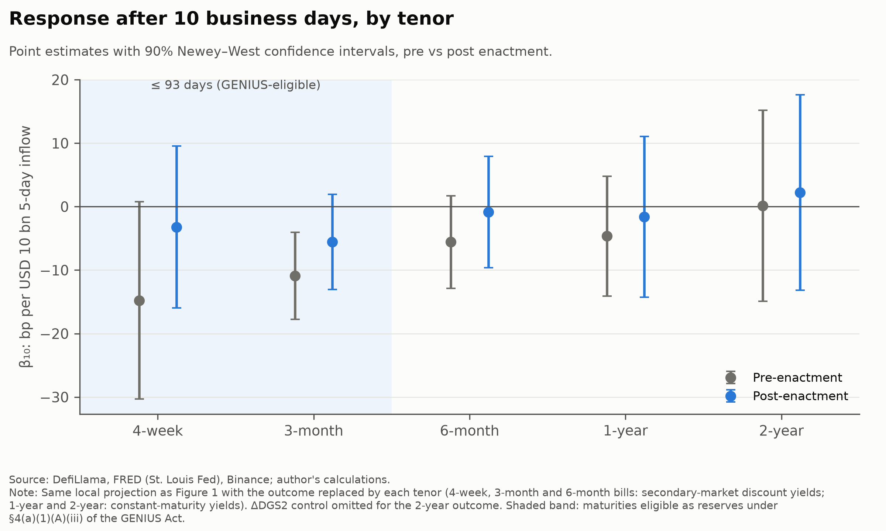
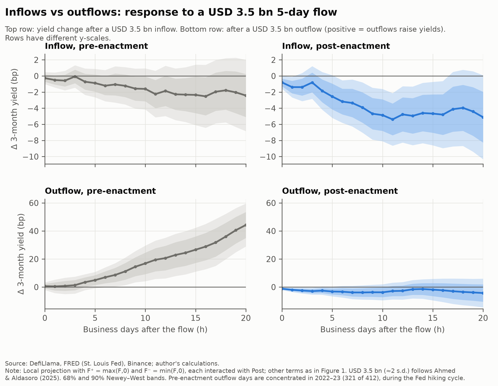

# Stablecoin flows and T-bill yields after the GENIUS Act

**Takeaway:** In the 15 months after the GENIUS Act became law, stablecoin inflows have *not* been associated with a larger fall in 3-month T-bill yields than before. The point estimate is about half the pre-enactment one, the difference is not statistically significant, and a placebo break a year earlier is larger still.

*A replication-in-spirit and extension of Ahmed & Aldasoro (2025, BIS Working Paper No 1270). Open data, pre-registered local projections, fully reproducible.*

---

## Abstract

Did the response of US T-bill yields to stablecoin flows change after the GENIUS Act (18 July 2025)? Using daily DefiLlama supply for eleven fiat-backed USD stablecoins and FRED yields, January 2021 to October 2026, we estimate pre-registered local projections with a post-enactment interaction.

Before enactment, a USD 10 bn five-day inflow is associated with a 10.9 bp lower 3-month yield after ten business days (90% CI −17.7 to −4.1). After enactment the estimate is −5.6 bp (90% CI −13.0 to +1.9). The difference, +5.3 bp (p = 0.30), has the opposite sign to our hypothesis.

We find no post-enactment shift towards the short end and no outflow dominance after enactment. A July 2024 placebo break is significant, so the relationship is unstable. The reserve rules bind only from 18 January 2027, and the post sample is short.

## 1. Why this matters

The BIS Annual Economic Report 2025, Chapter III ("The next-generation monetary and financial system"), argues that stablecoins fall short of the singleness, elasticity and integrity tests for the core of the monetary system. It also flags a market-footprint channel: major issuers "invest largely in safe assets", their Treasury holdings are "on par with large jurisdictions and government money market funds", and a USD 3.5 bn increase in market capitalisation "can already depress Treasury yields by around 2.5–5 basis points", with larger effects during redemptions and a tail risk of fire sales.

The GENIUS Act (Public Law 119-27) makes this channel a matter of law. It lists eligible reserves, and among Treasuries it admits only bills, notes or bonds with **93 days or less** of remaining maturity (§4(a)(1)(A)(iii)), alongside cash, deposits, overnight repos and government money market funds. If the channel is real, codifying it might strengthen it, or concentrate it at the very short end. This note asks whether that is visible in the data so far.

## 2. Data

- **Stablecoin supply.** DefiLlama daily circulating supply (`totalCirculating.peggedUSD`), with ids looked up by symbol.
  - **Primary aggregate:** eleven fiat-backed payment stablecoins: USDT, USDC, FDUSD, PYUSD, TUSD, USDP, BUSD (defunct, history kept), RLUSD, and three coins added by a pre-set ≥ USD 1 bn rule (USD1, USDG, USDGO). Tokenised funds (BUIDL) and crypto-collateralised or synthetic coins (DAI/USDS, USDe, …) are excluded.
  - **Secondary aggregate:** DefiLlama's total of all USD-pegged coins.
- **Timing.** A DefiLlama snapshot dated *d* (00:00 UTC) is treated as the end of US day *d*−1. A one-day shift is a robustness check.
- **Yields and controls (FRED).** DTB4WK, **DTB3**, DTB6, DGS1, DGS2 and EFFR, in basis points. VIX, S&P 500 and ON RRP also come from FRED; the BTC/USDT close comes from Binance.
- **Calendar and sample.** US business days on which DTB3 is quoted. The estimation sample runs from **4 January 2021 to 29 October 2026**: **1,135 pre-enactment and 322 post-enactment business days**. At h = 10, N_pre = 1,135 and N_post = 312.
- **Data quality.** Data vintage 31 October 2026. All data-sanity tests pass; the share of missing values after alignment is 0% for every regression variable.



## 3. Method

The pre-analysis plan ([docs/PAP.md](docs/PAP.md)) was committed before any regression was run. For h = 0,…,20:

```
y(t+h) − y(t−1) = α_h + β_h·F_t + δ_h·(F_t × Post_t) + γ_h·Post_t + Γ_h′X_t + ε(t+h)
```

- **Flow.** F_t is the 5-business-day change in aggregate supply, in USD bn. Post_t = 1 from 18 July 2025.
- **Controls (X_t).** Lags 1–5 of Δy and of the daily flow, plus same-day ΔDGS2 (policy expectations), ΔVIX, BTC and S&P 500 returns, and Δlog(RRP+1).
- **Bad-control check.** Same-day controls could respond to flows; a lags-only version changes nothing material.
- **Inference.** Newey–West standard errors with h+1 lags.
- **Reported quantities.** β (pre), β+δ (post) and δ, scaled per USD 10 bn.

## 4. Results

**Primary (Figure 1, Table 1).** A USD 10 bn five-day inflow is associated with:
- **pre-enactment:** a **10.9 bp** lower 3-month yield after 10 business days (SE 4.2; 90% CI −17.7 to −4.1);
- **post-enactment:** a **5.6 bp** lower yield (SE 4.5; 90% CI −13.0 to +1.9).

The difference, **+5.3 bp (SE 5.2, p = 0.30)**, is not statistically distinguishable from zero and has the opposite sign to H1. At the anchor paper's scale (USD 3.5 bn, about 2 s.d.) the figures are −3.8 bp pre and −1.9 bp post. Per one standard deviation of F (USD 1.81 bn) they are −2.0 bp and −1.0 bp.

The pre-enactment response keeps building to −23.9 bp at h = 20. The post-enactment response levels off near −7 bp around h = 11–13 and then fades. The gap widens with the horizon (δ₂₀ = +19.6 bp, p = 0.08), but no single horizon is significant at 5% and the points are highly correlated.



| h = 10, per USD 10 bn | Pre β | Post β+δ | δ |
|---|---|---|---|
| 3-month bill (DTB3) | −10.90 (4.16) | −5.56 (4.54) | +5.35 (5.21), p = 0.30 |

*(Full table, including h = 0, 5 and 20: [output/tables/table1_primary.md](output/tables/table1_primary.md).)*

**Term structure (Figure 2, Table 3).** Before enactment, β₁₀ shrinks with maturity:

| Tenor | Pre β₁₀ (bp per USD 10 bn) |
|---|---|
| 4-week | −14.8 |
| 3-month | −10.9 |
| 6-month | −5.6 |
| 1-year | −4.7 |
| 2-year | +0.1 |

Only the 3-month estimate is significant at 5% (4-week p = 0.12). The pattern is consistent with preferred-habitat demand, but it was **already present before the Act**. After enactment every tenor is smaller in magnitude and imprecise (4-week −3.2, 3-month −5.6, 6-month −0.8, 1-year −1.6, 2-year +2.2), and no tenor's δ₁₀ is significant (all p ≥ 0.26). H2 is not supported.



**Asymmetry (Figure 4, Table 4), per USD 3.5 bn at h = 10:**

| Regime | Inflow | Outflow | Equal-slope test |
|---|---|---|---|
| Pre-enactment | −1.6 bp (p = 0.30) | **+16.9 bp** (p = 0.03) | p = 0.07 |
| Post-enactment | −4.9 bp (p = 0.01) | −3.7 bp (p = 0.28) | p = 0.05 |

- **Pre-enactment:** outflows are associated with much larger yield moves than inflows, as in the May 2025 version of the anchor paper. But the magnitude is implausible (+44 bp at h = 20), and 321 of the 412 pre-enactment outflow days fall in the 2022–23 hiking cycle. We read this as rate-driven redemptions rather than fire-sale price impact.
- **Post-enactment:** outflows are associated with *lower*, not higher, yields. The equal-slope test rejects because the signs differ, not because outflows dominate. H3 is not supported after enactment.



**Spread.** For DTB3 − EFFR, δ₁₀ = −6.2 bp (p = 0.46) and neither regime is significant. We find no bill-specific premium beyond the policy rate.

## 5. Robustness

Table 2 ([output/tables/table2_robustness.md](output/tables/table2_robustness.md)) reports the pre-registered checks.
- **Non-placebo rows** (baseline; Senate-passage break; dropping ±10 days around Terra, FTX and SVB; USDT-only and USDC-only flows; the all-USD-pegged aggregate; the one-day timing shift; flow windows of 1 and 10 days; lags-only controls):
  - δ₁₀ is insignificant in all ten rows (smallest p = 0.20).
  - It is positive in nine of them. The exception is USDT-only flows (post −13.5 vs pre −10.7 bp; δ −2.8, p = 0.71).
- **The placebo break is the critical result.** A break on 18 July 2024, estimated on data ending before Senate passage, gives **δ = +23.1 bp (p = 0.002)**. The flow–yield association shifts substantially between sub-periods with no legislative event, so even a significant GENIUS δ could not have been attributed to the Act.

## 6. What this does NOT show

- **Endogeneity.** Flows respond to rates. Stablecoins are zero-yield, and the BIS documents larger redemptions after monetary tightening. Flows also respond to risk-on/off. Our estimates are conditional associations from a controls-only design, not causal effects. Ahmed & Aldasoro use a granular instrument; we do not.
- **Short post sample and low power.** With N_post = 312, the minimum detectable δ₁₀ at 80% power is roughly 15 bp per USD 10 bn, larger than the entire pre-enactment estimate. A null here is weak evidence of no change.
- **The Act is not yet binding.** Reserve requirements take effect on 18 January 2027 (§20; the OCC's final rule of 21 October 2026 confirms this date). "Post" is an anticipation regime, which also coincides with Fed easing.
- **Measurement.** DefiLlama supply is not reserve purchases; the mapping to T-bill demand varies by issuer and over time.
- **Inference.** Overlapping horizons make IRF points highly correlated. We do not adjust for testing 5 tenors × 21 horizons.

## 7. Relation to Ahmed & Aldasoro (2025)

- **What we replicate.** Their flow definition (five-day change in supply, on trading days), their outcome (the 3-month bill), local projections and Newey–West bands. Our five-day flow moments (mean USD 0.83 bn, s.d. 1.81) closely match theirs (0.88, 1.74).
- **What differs.**
  - We use a much smaller control set and no instrument.
  - Our pre-enactment estimate (−3.8 bp per USD 3.5 bn) resembles their June 2026 *IV* estimate (about −4 bp at 10 days). It is far larger than their *controls-only* estimate (< 1 bp, insignificant), which suggests our β still contains confounding that their lead-yield and policy-shock controls remove.
  - The headline numbers quoted in the BIS report (2–2.5 bp; outflows two to three times inflows) are from the May 2025 version. The June 2026 revision reports 0.71 bp on impact and about 4 bp within 10 days, and drops the asymmetry result.
- **What we add.**
  - A legal-event break rather than a sector-scale proxy (they use a post-2024 dummy and find a *stronger* channel; our controls-only placebo at July 2024 points the other way).
  - A term-structure test motivated by the 93-day rule.
  - A post-enactment sample through October 2026, seven months beyond theirs.

## 8. Reproduce

```bash
python3 -m venv .venv && .venv/bin/pip install -r requirements.txt
make all        # build -> tests -> estimate -> figures -> tables (uses committed raw data)
make refresh    # re-download all sources (new vintage) and rebuild
```

Data vintage: 31 October 2026 (DefiLlama, FRED, Binance). The raw files are timestamped in `data/raw/`. The running log is in [docs/FINDINGS.md](docs/FINDINGS.md). `src/utils.py` (config, logging, cached HTTP) is added to the planned layout. The CoinGecko and Treasury fallback sources are configured but were not needed and are not implemented. Repository: https://github.com/<my-handle>/stablecoin-tbills-genius-act

## 9. References

- Ahmed, R. and I. Aldasoro (2025), "Stablecoins and safe asset prices", *BIS Working Papers* No 1270, May 2025 (revised June 2026).
- Bank for International Settlements (2025), *Annual Economic Report 2025*, Chapter III, "The next-generation monetary and financial system", June.
- Jordà, Ò. (2005), "Estimation and inference of impulse responses by local projections", *American Economic Review* 95(1), 161–182.
- Newey, W. K. and K. D. West (1987), "A simple, positive semi-definite, heteroskedasticity and autocorrelation consistent covariance matrix", *Econometrica* 55(3), 703–708.
- Guiding and Establishing National Innovation for U.S. Stablecoins (GENIUS) Act, Public Law 119-27, 139 Stat. 419, 18 July 2025.
- Office of the Comptroller of the Currency (2026), Bulletin 2026-50, final rule implementing the GENIUS Act, 21 October 2026.

*Views and errors are the author's own. This is an independent research note, not investment advice.*
