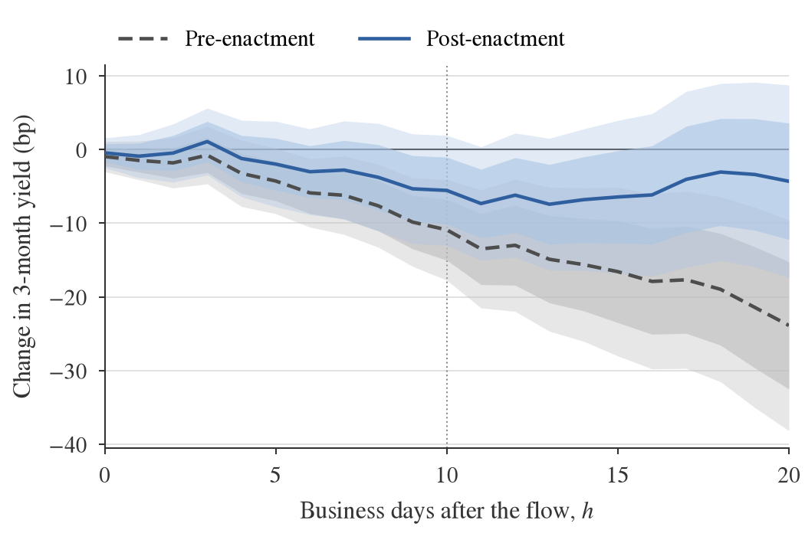

<p align="center"></p>

<h1 align="center">Stablecoin flows and T-bill yields after the GENIUS Act</h1>

[](https://doi.org/10.5281/zenodo.23836447)
[](https://github.com/thanatchon36/stablecoin-tbills-genius-act/actions/workflows/ci.yml)
[](https://thanatchon36.github.io/stablecoin-tbills-genius-act/)
[](https://github.com/thanatchon36/stablecoin-tbills-genius-act/raw/main/paper/paper.pdf)
[](https://huggingface.co/datasets/thanatchon36/stablecoin-tbills-genius-act)
[](docs/PAP.md)
[](LICENSE)

🌐 **[Read the paper online](https://thanatchon36.github.io/stablecoin-tbills-genius-act/)** ·
📄 **[Download the PDF](https://github.com/thanatchon36/stablecoin-tbills-genius-act/raw/main/paper/paper.pdf)** ·
🤗 **[Data](https://huggingface.co/datasets/thanatchon36/stablecoin-tbills-genius-act)** ·
📝 **[Pre-analysis plan](docs/PAP.md)**

**Do stablecoin flows move US Treasury-bill yields differently after the GENIUS Act?** The Act (Public Law 119-27,
signed 18 July 2025) restricts the Treasury reserves of US payment-stablecoin issuers to securities maturing within
93 days. This repository tests whether the flow–yield association documented by Ahmed & Aldasoro (2025, BIS Working
Paper No 1270) changed after enactment, with open data and pre-registered local projections.

**Takeaway:** in the 15 months after the GENIUS Act became law, stablecoin inflows have *not* been associated with a
larger fall in 3-month T-bill yields than before.

- **Primary (H1):** −10.9 bp before vs −5.6 bp after, per USD 10 bn five-day inflow at 10 business days. The
  difference, +5.3 bp (p = 0.30), has the opposite sign to the hypothesis.
- **Term structure (H2):** the short-end concentration (4-week −14.8 bp, 2-year ≈ 0) was already there before the Act.
- **Asymmetry (H3):** before enactment, outflows are associated with much larger moves than inflows. After
  enactment the asymmetry is absent.
- **Caveat:** a placebo break in July 2024 is larger and significant (+23.1 bp, p < 0.01). The reserve rules bind only
  from 18 January 2027, and the design has little power (minimum detectable change ≈ 15 bp). These are
  associations, not causal effects.

<p align="center"></p>

Method, results, robustness and limitations are in the paper:
**[web version](https://thanatchon36.github.io/stablecoin-tbills-genius-act/)** or
**[PDF](https://github.com/thanatchon36/stablecoin-tbills-genius-act/raw/main/paper/paper.pdf)** (7 pages).

## Reproduce

```bash
python3 -m venv .venv && .venv/bin/pip install -r requirements.txt   # Python >= 3.11, pinned versions
make all        # panel -> tests -> estimates -> figures -> tables -> paper numbers/tables/figures
make paper      # paper/paper.pdf (pinned Tectonic, SHA-256 checked) + web version docs/paper/ (needs pandoc)
make refresh    # re-download every source (new vintage) and rebuild
```

- **Deterministic:** `make all` takes under a minute and every output is byte-identical across runs. CI rebuilds on
  each push and fails if any number in the paper or tables changes.
- **No hand-typed numbers:** every number in the paper is a LaTeX macro written by
  [`src/viz/paper_tex.py`](src/viz/paper_tex.py) from `output/tables/lp_results.json`.
- **Pre-registered:** hypotheses, specification, robustness list and decision rules were committed in
  [`docs/PAP.md`](docs/PAP.md) before any yield data were downloaded. Log: [`docs/FINDINGS.md`](docs/FINDINGS.md).

| Path | Contents |
|---|---|
| `src/data/` | Fetchers (DefiLlama, FRED, Binance) and panel construction |
| `src/analysis/` | Local projections (`lp.py`) and every pre-registered specification (`robustness.py`) |
| `src/viz/` | Figures, tables, and the paper's numbers/tables (`paper_tex.py`) and figures (`paper_figures.py`) |
| `tests/` | Data-sanity tests (dates, coverage, NaNs, levels vs the anchor paper) |
| `paper/` | LaTeX source, generated `numbers.tex`, `tables/`, `figures/`, `paper.pdf`; `web.py` builds the web version |
| `docs/` | Pre-analysis plan, research log, Thai summary; `docs/paper/` is the web version (GitHub Pages) |

## Data

Vintage 31 October 2026: DefiLlama stablecoin supply, FRED yields and rates, Binance BTC/USDT. Raw downloads are kept
unedited and timestamped in `data/raw/`, and mirrored on
[Hugging Face](https://huggingface.co/datasets/thanatchon36/stablecoin-tbills-genius-act) with per-source terms.
The S&P 500 and VIX series are copyrighted and **not redistributed**: `make all` downloads them from FRED on first run
(network needed), and `data/processed/panel.parquet` is rebuilt locally rather than committed.

## Citation

See [`CITATION.cff`](CITATION.cff), or:

```bibtex
@techreport{chongmankhong2026genius,
  author      = {Chongmankhong, Thanatchon},
  title       = {Stablecoin Flows and Treasury-Bill Yields after the {GENIUS} Act: A Pre-Registered Replication-in-Spirit},
  year        = {2026},
  type        = {Working paper},
  doi         = {10.5281/zenodo.23836447},
  url         = {https://thanatchon36.github.io/stablecoin-tbills-genius-act/}
}
```

## License

Code and text: [Apache-2.0](LICENSE). Data remain subject to their providers' terms (DefiLlama, FRED and its
sources, Binance); see the [dataset card](https://huggingface.co/datasets/thanatchon36/stablecoin-tbills-genius-act).

*Views and errors are the author's own. This is an independent research note, not investment advice.*
